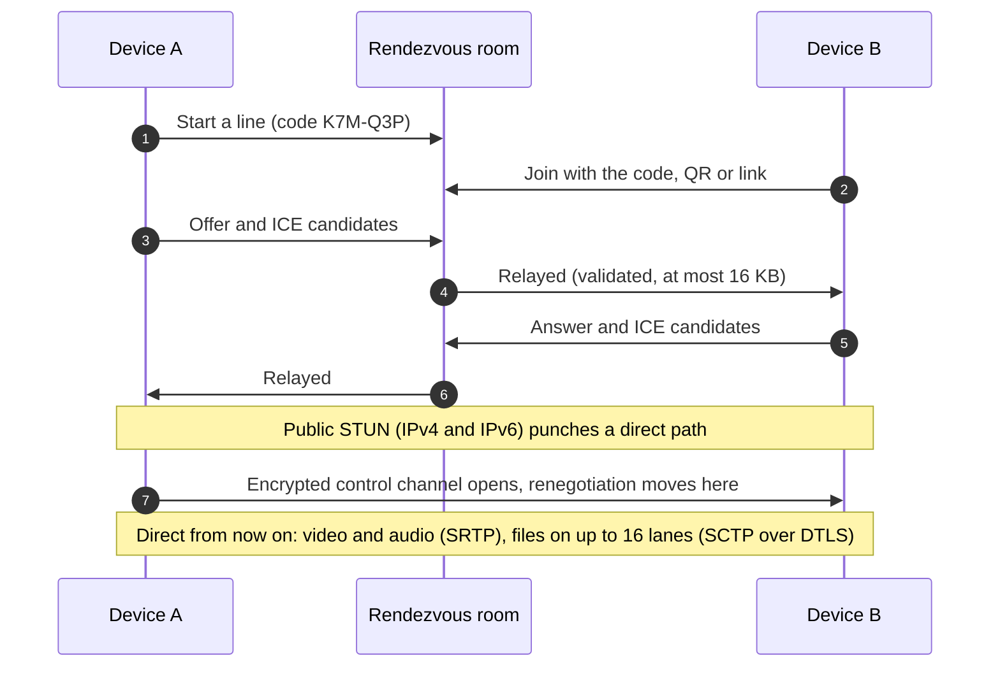
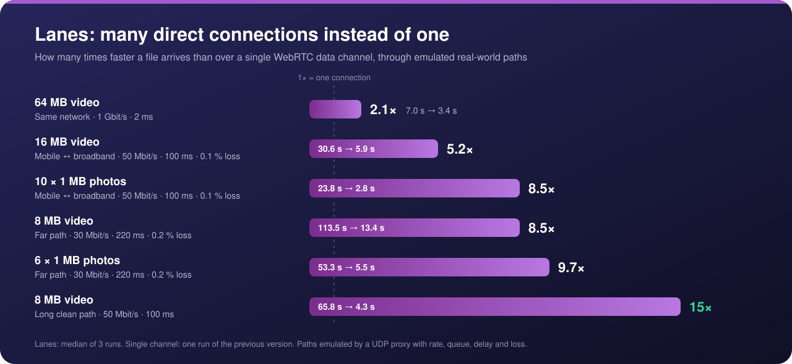
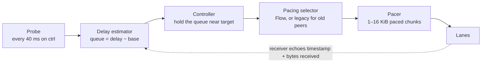
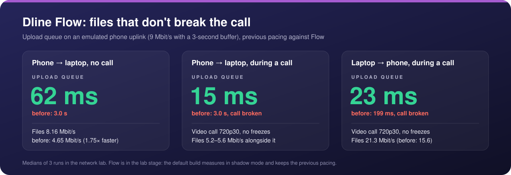
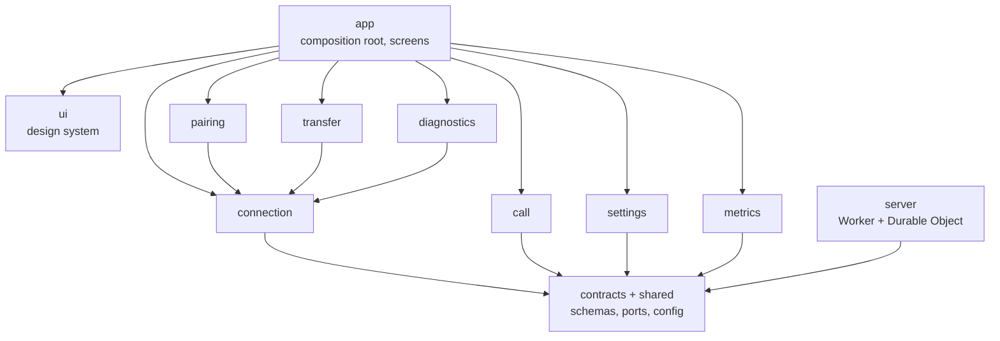

<div align="center">



<br>
<br>

**Peer-to-peer video calls and full-quality file sharing between two devices on two different networks, straight from a web page.**

No app to install. No account. No media server.

<br>


[The challenge](#the-challenge) · [Features](#features) · [How it works](#how-it-works) · [Speed](#speed) · [Architecture](#architecture) · [Getting started](#getting-started)

</div>

<br>

<table>
  <tr>
    <td align="center" width="25%"><h2>~1 s</h2><sub>to pair two devices</sub></td>
    <td align="center" width="25%"><h2>0 bytes</h2><sub>of media through any server</sub></td>
    <td align="center" width="25%"><h2>up to 15×</h2><sub>faster files than one connection</sub></td>
    <td align="center" width="25%"><h2>3 s → ~60 ms</h2><sub>ping while a 5G phone sends files during a call</sub></td>
  </tr>
</table>

## The challenge

Dline started as a challenge with a strict set of rules. Each one is met like this:

| Rule | How Dline meets it |
| :-- | :-- |
| **Two devices, two different networks** | WebRTC with trickle ICE, STUN over IPv4 and IPv6, and an ICE restart when a device switches networks |
| **Share images and videos, and make a camera call** | A one-to-one 720p30 call and files of any type and size, at the same time, over the same connection |
| **Entirely peer-to-peer** | Media is DTLS-SRTP and files are SCTP over DTLS, device to device. The connection panel shows *0 bytes through any relay* as proof |
| **A server only for hole punching** | A tiny rendezvous room swaps the handshake (SDP and ICE, at most 16 KB per message) and nothing else. **Links-only mode needs no server at all** |
| **Reliable** | Heartbeat, automatic recovery, a network pre-check, and a clear explanation when a direct path is impossible |
| **Fast** | Pairing in about a second; files at raw data-channel speed locally and **5–15× faster than one connection** on long or lossy paths |

> [!NOTE]
> When a direct path truly can't exist (strict NAT on both sides, UDP blocked, or IPv4-only on one side and IPv6-only on the other), Dline says so and names the likely cause. A TURN relay can be switched on in Settings, but it is off by default and always labelled *Relayed, not peer-to-peer*. **Dline never relays silently.**

## Features

<table>
  <tr>
    <td width="50%" valign="top">
      <h3>📞 Calls that survive the real world</h3>
      Perfect negotiation, in-band renegotiation over an encrypted control channel, transceivers reused across calls, ICE restarts that survive a Wi-Fi → mobile switch, and a watchdog that reports a lost connection within 15 seconds.
    </td>
    <td width="50%" valign="top">
      <h3>🔗 Pair with a server, or without one</h3>
      A room code, QR code or link through a Cloudflare Durable Object, or a serverless swap of two links through any chat app. The handshake is packed into an invite link of under 260 characters, carried in the URL fragment that browsers never send to a server.
    </td>
  </tr>
  <tr>
    <td width="50%" valign="top">
      <h3>🛤️ Multi-lane file transfer</h3>
      Files are cut into 128 KB blocks, each checked with SHA-256, and spread over up to 16 parallel direct connections. Blocks arrive in any order and are written by position. Large files stream to disk (OPFS) instead of memory.
    </td>
    <td width="50%" valign="top">
      <h3>🌊 Dline Flow pacing</h3>
      A delay-based controller that stops file transfers from flooding a phone's upload buffer, so the video call stays smooth while files are moving. While you send files during a call, <b>Files first</b> sends your camera at 360p so the upload goes to the files, then restores it 3 s after the last one. Older peers fall back to the previous pacing automatically.
    </td>
  </tr>
  <tr>
    <td width="50%" valign="top">
      <h3>🔍 Honest diagnostics</h3>
      A live path badge, round trip, bitrate, loss and codec, <b>session stats</b> (live upload and download speed with a one-minute graph, totals, average and peak), a network pre-check (Good / Risky / Blocked), a "no direct path" screen that explains why, and a 4-word <b>safety code</b> from both DTLS fingerprints that shows nobody is in the middle.
    </td>
    <td width="50%" valign="top">
      <h3>🧪 A network lab on one laptop</h3>
      A UDP proxy that emulates real links (rate, queue depth, delay, loss, asymmetric phone uplinks) with real browsers forced through it. Every speed claim in this README is measured, not assumed.
    </td>
  </tr>
</table>

## How it works



1. **Pairing.** One device starts a line and gets a code, a QR code and a link. The other joins. The rendezvous room relays only the handshake, never media.
2. **Connecting.** Both browsers gather candidates through public STUN servers and punch a direct path. Once the control channel opens, everything else travels over it, peer to peer.
3. **Calling.** One audio and one video transceiver per connection, reused for every call, so the session description never grows. Turning the camera off really stops it: the light goes off.
4. **Sending files.** Blocks go to whichever lane has room. The receiver writes them by position, checks each SHA-256 and acknowledges it. An overdue block is re-sent on another lane, so one lane recovering from loss can't hold up the end of a file.

## Speed

### Lanes: many direct connections instead of one

One WebRTC data channel sends one congestion window per round trip and halves it on every loss. On a long or lossy path that caps it far below the link: about **0.45 MB/s on a 100 ms path with 0.1 % loss**, whether the link is 5 or 500 Mbit/s. Bigger buffers don't help.

So Dline opens **extra direct connections, called lanes,** next to the main one. They are negotiated in-band and use STUN only, never a relay. Each lane has its own window, so throughput grows with the lane count: 3 extra lanes when the devices are near (lowest round trip ≤ 20 ms) and 15 when they are far.

<p align="center">
  
</p>

<details>
<summary><b>Full results table</b></summary>

<br>

| Path | File | Single channel | Lanes | Faster |
| :-- | :-- | --: | --: | --: |
| Same network (1 Gbit/s, 2 ms) | 64 MB video | 7.0 s | 3.4 s | 2.1× |
| Mobile ↔ broadband (50 Mbit/s, 100 ms, 0.1 % loss) | 16 MB video | 30.6 s | 5.9 s | 5.2× |
| | 10 × 1 MB photos | 23.8 s | 2.8 s | 8.5× |
| Far path (30 Mbit/s, 220 ms, 0.2 % loss) | 8 MB video | 113.5 s | 13.4 s | 8.5× |
| | 6 × 1 MB photos | 53.3 s | 5.5 s | 9.7× |
| Long clean path (50 Mbit/s, 100 ms) | 8 MB video | 65.8 s | 4.3 s | 15× |

Lanes: median of 3 runs. Single channel: one run of the previous version.

</details>

### Dline Flow: files that don't break the call

The first real-network test (a laptop on Wi-Fi, a phone on 5G) exposed something the lab hadn't: phone uplinks don't drop packets when they're full, they **queue seconds of data**. While the phone sent a file during a call, the ping climbed to about 3 seconds and the file crawled.

Flow fixes that with a receiver-clocked control loop over the whole bundle of lanes, modelled on SCReAM v2's "virtual L4S" design:



- **See the queue within a round trip.** The receiver echoes every probe with its own timestamp and the bytes it has received.
- **Hold the queue near a small target:** 30 ms during a call, 60 ms otherwise. The rate is cut in proportion to the queue and regrows carefully near the last congestion point.
- **The call comes first.** During a call, files stay below the bottleneck minus the call's share. That share is measured only on quiet paths: on a jittery radio link, where a capacity reading would be wrong, the call is protected by the delay target alone.
- **Radio noise is not congestion.** Flow learns how much the delay jitters on an idle path (the 90th percentile of clean readings) and keeps its target at least twice that, up to 100 ms, so 5G jitter doesn't throttle files to a crawl.
- **Files first.** While this device sends files during a call, its camera goes out at 360p and at most 500 kbit/s, and the call's share shrinks to room for twice that cap. The cap waits 3 s after the last file before lifting, so files sent one after another don't make the video change size and freeze, and the camera is back at full size about a second later.
- **No bursts.** Blocks leave as paced 1–16 KiB pieces instead of 128 KB bursts, and short validation pauses (with a marker on every lane) prove the base delay was measured on an empty path.

<p align="center">
  
</p>

<details>
<summary><b>Full lab results</b></summary>

<br>

Emulated 9 Mbit/s phone uplink with a 3 s buffer; medians of 3 runs, previous pacing against Flow.

| Scenario | Previous: files / queue | Flow: files / queue | Video call |
| :-- | :-- | :-- | :-- |
| Phone → laptop, no call | 4.65 Mbit/s / 3.0 s | **8.16 Mbit/s / 62 ms** | – |
| Phone → laptop, during a call | 5.44 Mbit/s / 3.0 s, call broken (0 of 3) | 5.20–5.56 Mbit/s / **15 ms** | **720p30, no freezes** |
| Laptop → phone, during a call | 15.6 Mbit/s / 199 ms, call broken (0 of 3) | **21.3 Mbit/s / 23 ms** | 720p30, no freezes |
| Fluctuating uplink (5–12 Mbit/s), during a call | 4.07 Mbit/s / 3.0 s | 2.33 Mbit/s / **15 ms** | protected first |
| Phone → laptop, during a call, **with Files first** | | **7.03–7.19 Mbit/s / ~7 ms** (4 runs) | sender's camera 360p30 while sending, back to 720p 3 s after the last file |
| Laptop → phone, during a call, **with Files first** | | **21.6–23.3 Mbit/s / ~15 ms** (4 runs) | same |

With Files first, a single short freeze (about 0.3 s) still shows up in some fast-link runs; it is being looked into.

On paths that don't queue (same network, far, long clean path) Flow matches or beats the old pacing: 100 %, 113 % and 109 %. One case is still open: a mobile path without a call starts slower (86 % of the old pacing), because Flow's paced start feeds the 16 lanes a few at a time.

</details>

### In the field

A laptop on Airtel Wi-Fi and a phone on Jio 5G, direct over the internet, with a video call running while the phone sends a large video (67 MB before, 74.7 MB now):

| Version | File speed | Ping | Phone's video |
| :-- | --: | :-- | :-- |
| Previous pacing | 0.26–0.44 MiB/s | **2.9–3.5 s** | call lagging by seconds |
| **Flow with Files first** | **848 KB/s** (1.2 MB/s at the end) | **56–83 ms** | 270×480 at 30 fps while sending, full size 3 s after |

The other way, laptop → phone, the same file took 40 s (1.88 MB/s). Every file was verified with SHA-256.

**Live benchmark, 4 November 2026.** Same laptop and phone on the production app. The 74.7 MB video was sent 3 times per test, and the numbers come from the app's own performance reports in the server log:

| Test | Call | Median | Range (MB/s) | Ping | Lanes |
| :-- | :-: | --: | --: | :-- | :-: |
| Phone → laptop, same Wi-Fi | off | **5.83 MB/s** | 5.48–5.96 | 30–80 ms | 4 |
| Phone on Jio 5G → laptop | off | **1.02 MB/s** | 0.97–1.07 | 58–148 ms | 16 |
| Phone on Jio 5G → laptop | on | **1.00 MB/s** | 0.89–1.28 | 61–160 ms | 16 |
| Laptop → phone on Jio 5G | on | **2.55 MB/s** | 0.93–3.61 | 60–149 ms | 16 |

All 12 files were verified, with no connection dropped. On 5G the phone's upload is the limit: Dline used about 8.2 of its roughly 9.4 Mbit/s, and the call didn't slow files down.

Switching the phone from Wi-Fi to 5G mid-call first ended in "Connection lost", which exposed two bugs:
- The ICE restart was sent on the old direct channel, which still reads "open" for half a minute after the path dies. It now goes through the rendezvous while the connection is recovering.
- The lane count kept the Wi-Fi round trip. A new path is now measured afresh.

After both fixes the call and the transfer recover on their own, with 16 lanes.

> [!NOTE]
> **Flow is on by default.** Add `?pacing=legacy` for the previous pacing, `?pacing=shadow` to let Flow only measure, or `?debug=1` to show the mode and download a pacing trace. Share links carry the switches, so both devices always match.

### Live and in the logs

**In the app:** the **Session stats** card in the room shows file speed both ways as it happens, a one-minute graph, the totals, the average and the peak, and during a call both videos' resolution and frame rate. The average counts only the time files were moving, so idle minutes don't dilute it.

**In the server log:** each device reports, with numbers only, how it connected, every finished file and the session's totals to `POST /api/metrics`. The Worker validates each report, rate-limits it (30 a minute per address) and writes one readable line with the fields attached. For example:

```text
connect: connected in 1.4s · internet IPv6 (srflx ↔ prflx) · ping 61 ms
transfer out done: 71.2 MB of 71.2 MB in 1m 30s at 811 KB/s · 16 lanes · internet IPv6 (srflx ↔ prflx) · ping 60 ms · call on · pacing flow
session: ended (left) after 4m 12s · up 71.2 MB in 1 file, avg 811 KB/s, peak 1.15 MB/s · down 0 B in 0 files, … · call 3m 40s · 0 recoveries · up to 16 lanes
connect: FAILED after 20s · causes unknown · local udp yes, IPv4 symmetric, IPv6 no · remote udp yes, IPv4 cone, IPv6 no
```

Read them live with `npx wrangler tail dline-v4 --search "transfer"`, or search past ones in the Cloudflare dashboard (**Workers & Pages → dline-v4 → Logs**, for example `metrics.t = transfer`). A failed connect records both networks' NAT type and IPv6 support, so "no direct path" can be explained after the fact.

### On one laptop

Pairing in about 1 s. A 32 MB file at **23 MB/s**, against one raw data channel's 20–23 MB/s, and the same speed during a video call. First load is **71 KB of JavaScript and 9 KB of CSS** (gzipped); repeat visits load from the service worker.

## Using it

1. **Start a line.** You get a code, a QR code and a link.
2. **The other person joins** by opening the link, scanning the QR code or typing the code.
3. **You're connected.** Start a video call, send photos, videos or any other file (PDF, ZIP, documents…), or both at once. Photos and videos get a preview, other files a Save button, and files that can run programs (APK, EXE…) a warning.

> [!TIP]
> **No server at all:** tap *Pair with links instead* and swap an invite link and a reply link through any chat app.

The band at the top draws the connection as a two-station metro line from **You** to **Them**: dashed while it's being built, solid when direct, with a *Relay* interchange when relayed, and broken when lost. Each tick on the line is a lane carrying files. Below the files, **Session stats** shows the live speed both ways and what the session has moved. Tap the plate for the details: candidate types, round trip, upload queue, bitrate, packet loss, video resolution and codec, and the **safety code**. If both people see the same four words, nobody is in the middle.

## Architecture

A **modular monolith**: one repository, one package and **one deployable**, a Cloudflare Worker that serves the static app and hosts the rendezvous Durable Object.



<details>
<summary><b>Code map</b></summary>

<br>

```
src/
  app/            composition root (session state machine), Svelte screens and components
  modules/        each module exposes only its index.ts; everything else is private
    connection/   peer connection, perfect negotiation, control channel, heartbeat, watchdog, lanes
    pairing/      rendezvous client, compact link codec, same-browser handoff
    call/         call state machine, transceiver reuse, camera and microphone
    transfer/     block scheduler, SHA-256 per block, file sinks (RAM / OPFS), Flow pacing
    diagnostics/  stats → path badge, network pre-check, no-path diagnosis, safety code
    settings/     opt-in TURN, the performance-stats switch, safe local storage
    metrics/      session totals and live speeds, performance reports (sent once each)
  contracts/      valibot message schemas and ports (interfaces), shared by app and Worker
  shared/         config (every tunable), emitter, timers, formatting, ICE candidate parsing
  ui/             presentational design system, with no access to modules
  server/         Worker entry, the RendezvousRoom Durable Object and the metrics endpoint
tests/
  e2e/            two-browser Playwright tests with a fake camera
  bench/          the network lab: UDP proxy, emulated paths, throughput and call-quality runs
```

</details>

**The rules are enforced, not just written down.** `npm run check` fails if any of them break:

| Rule | Enforced by |
| :-- | :-- |
| Module boundaries: no deep imports, no shortcuts between modules, no cycles, no framework code inside modules | dependency-cruiser |
| No copy-paste: 0 duplicated blocks | jscpd |
| Every file sink and every pacing policy is interchangeable (Liskov) | shared contract tests |
| Browser APIs injected through small ports, wired in one place, so the core is testable without a browser | TypeScript + unit tests |
| Untrusted input (control messages, file data, links, rendezvous) parsed with schemas before use | valibot |

## Getting started

Requires **Node.js 22.12** or newer.

```bash
npm install
npm run dev        # app + Worker + Durable Object locally at http://localhost:5173
npm run check      # types, lint, module boundaries, duplicates, unit and Worker tests
npm run e2e        # two-browser end-to-end tests with a fake camera
```

Camera access needs HTTPS or `localhost`; Cloudflare Workers serve HTTPS by default.

<details>
<summary><b>Run the speed lab</b></summary>

<br>

The lab always runs the production build.

```bash
# Throughput through emulated real-world paths
BENCH=lan,mobile,far,clean npx playwright test -c playwright.bench.config.ts tests/bench/app.spec.ts --repeat-each 3

# Phone uplink scenarios with a video call running, Flow against the previous pacing
BENCH=cell-up,cell-down,cell-var CALL=1 PACING=flow npx playwright test -c playwright.bench.config.ts tests/bench/app.spec.ts --repeat-each 3
```

Each run appends to `test-results/bench-results.jsonl` and prints medians at the end. `E2E_PREVIEW=1 npm run e2e` runs the end-to-end suite against the production build in workerd.

</details>

<details>
<summary><b>Deploy to Cloudflare</b></summary>

<br>

Needs a Cloudflare account.

```bash
npm run deploy           # production Worker (dline-v4)
npm run deploy:staging   # separate test Worker (dline); its rooms never mix with production's
```

</details>

## Testing

| Layer | What it covers |
| :-- | :-- |
| **Unit and Worker** <br><sub>Vitest · 338 tests</sub> | Negotiation, signal routing while recovering, lanes, framing, scheduling, resend, every Flow component, a simulated bottleneck with radio jitter and stalls, the Files first video cap, mixed old and new peers, the rendezvous Durable Object and the metrics endpoint in workerd |
| **End to end** <br><sub>Playwright</sub> | Pairing by code and by links, a full video call, files both ways during a call verified by SHA-256, any file type, session stats and performance reports (and none when turned off), leave detection, localhost throughput |
| **Network lab** <br><sub>`tests/bench`</sub> | Real browsers through emulated links: throughput, queueing delay and call quality (bitrate, frame rate, freezes, second by second, and how fast the video recovers after a transfer) |

## Privacy and security

- 🔒 **Media and files never touch a server.** The rendezvous sees only the handshake, and links-only mode uses no server at all.
- 🔐 **Everything between the devices is encrypted** with DTLS-SRTP and DTLS.
- 🗣️ **The safety code** lets two people confirm, out loud, that their connection is end to end.
- 📊 **Performance stats are numbers only.** Sizes, speeds, timings, the connection type, the browser and the app version, never file names, contents or addresses in the report. They go to the Worker's log and nowhere else. On by default, off with one switch in **Settings → Share performance stats**.
- 🧹 **No accounts, no stored calls or files.** Received files live in memory or the browser's private storage and are cleared on the next start.

## Known limits

- **Both sides need a good network connection.** Dline can only be as fast and smooth as the two networks under it. On a weak or unstable signal the ping jumps, files slow down and the call stutters, whatever the app does. A dropped connection is restarted after 5 s; with no recovery after 15 s the session ends as "Connection lost".
- **File speed is set by the sender's upload.** Mobile networks upload far slower than they download: on Jio 5G we measured about 9.4 Mbit/s up (1.12 MiB/s) against 3.44 MiB/s down. During a call, Flow keeps the upload queue short so the call stays smooth, which leaves files 848 KB/s.
- **Some pairs of networks can't connect directly.** Carrier NAT on both sides, a VPN, or iCloud Private Relay can leave no direct path. Dline then says "No direct path" with the likely cause; the relay (TURN, opt-in in Settings) is the fallback.
- **Up to 16 parallel connections (lanes) per session**: 4 on the same network, 16 over the internet. More would only add queue.
- **Files up to 64 GB.** Anything over 64 MB is written to the browser's private storage, so the receiving device needs that much free space.
- A browser can't keep a call running in the background like a native app.
- Each side sees the other's public IP address; that is inherent to a direct connection.
- One-to-one only. Group calls would need a media server.
- Instagram and Facebook in-app browsers may block the camera. Dline detects them and explains how to open the link in Chrome or Safari.

<details>
<summary><b>Real-network test matrix</b> (filled in as each combination is tried)</summary>

<br>

| # | Device A network | Device B network | Expected path | Result |
| :-: | :-- | :-- | :-- | :-- |
| 1 | Home Wi-Fi | Same Wi-Fi | Direct, same network | ✅ Direct (IPv6), 4 lanes. Phone → laptop 5.83 MB/s median at 30–80 ms ping |
| 2 | Home Wi-Fi | Jio 5G | Direct, likely IPv6 | ✅ Direct (IPv6, later IPv4). During a call, phone → laptop 848 KB/s at 56–83 ms ping; laptop → phone 1.88 MB/s |
| 3 | Jio 5G | Airtel 4G/5G | Direct, likely IPv6 | |
| 4 | Airtel | Vi | Unknown | |
| 5 | Mobile hotspot | IPv4-only broadband | May fail without TURN | |
| 6 | Any | Any, TURN on | Relayed | |
| 7 | Wi-Fi, switched to mobile mid-call | Any | Recovers via ICE restart, else "lost" | ✅ After two fixes: the call and the file carry on, and lanes grow back to 16 on the new path |
| 8 | Laptop (Wi-Fi) | iPad (mobile hotspot) | Direct | |

</details>

## Tech stack

<table>
  <tr>
    <td><b>App</b></td>
    <td>Svelte 5 · TypeScript · Vite · Tailwind CSS v4 · installable PWA</td>
  </tr>
  <tr>
    <td><b>Real-time</b></td>
    <td>WebRTC: SRTP media, SCTP data channels, trickle ICE, STUN over IPv4 and IPv6</td>
  </tr>
  <tr>
    <td><b>Server</b></td>
    <td>Cloudflare Workers · Durable Objects (rendezvous only)</td>
  </tr>
  <tr>
    <td><b>Quality</b></td>
    <td>valibot · Vitest · Playwright · dependency-cruiser · jscpd · ESLint</td>
  </tr>
</table>

<br>

<div align="center">

Works in Chrome, Edge, Firefox and Safari (iOS 16.4+), on phones, tablets, laptops and desktops, in any mix.

<br>

<sub>Built by <a href="https://github.com/hackeradhii">Adhii</a></sub>

</div>
