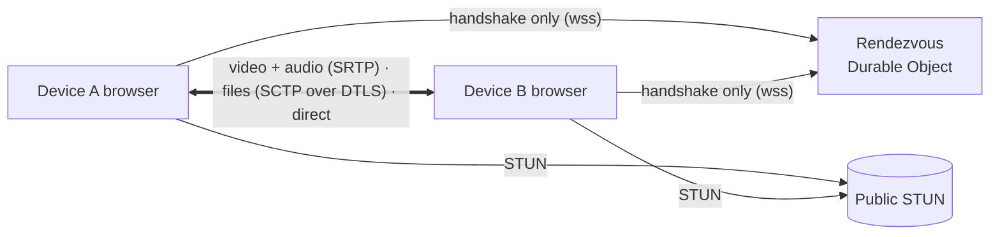

# Dline

**Peer-to-peer video calls and full-quality file sharing between two devices on two different networks, from a web page.**

No app, no account, no media server. Open the page, share a code, and the two devices connect directly: the video call, the photos, the videos and any other file go device to device. A server is used only to help the two devices find each other (NAT hole punching), and it never sees a single byte of media.

**Live:** [dline.adhi-dev.workers.dev](https://dline.adhi-dev.workers.dev) · Chrome, Edge, Firefox and Safari (iOS 16.4+) on phones, tablets, laptops and desktops, in any mix.

---

## The challenge

Dline started as a challenge with a strict set of rules:

| Rule | How Dline meets it |
| --- | --- |
| Two devices on two different networks | WebRTC with trickle ICE, STUN over IPv4 and IPv6, and an ICE restart when a device switches networks |
| Share images and videos, and make a camera video call | One-to-one 720p30 call plus file transfer of any type and size, at the same time, over the same connection |
| Entirely peer-to-peer | Media is DTLS-SRTP and files are SCTP over DTLS, both device to device. The connection panel shows *0 bytes through any relay* as proof |
| A server only for hole punching | A tiny rendezvous room swaps the WebRTC handshake (SDP and ICE candidates, at most 16 KB per message) and nothing else. A **links-only mode needs no server at all** |
| Reliable | Heartbeat, automatic recovery, a network pre-check, and a clear explanation when a direct path is impossible |
| Fast | Pairing in about a second; files reach the raw data-channel speed locally and are **5–15× faster than a single connection** on long or lossy paths |

When a direct path truly can't exist (strict NAT on both sides, UDP blocked, IPv4-only on one side and IPv6-only on the other), Dline says so and names the likely cause. A TURN relay can be switched on in Settings, but it is off by default and always labelled *Relayed, not peer-to-peer*. Dline never relays silently.

## What I built

- **A complete WebRTC app, from pairing to recovery.** Perfect negotiation, in-band renegotiation over a control channel, transceiver reuse across calls, ICE restarts that survive a Wi-Fi to mobile switch, and a watchdog that reports a lost connection within 15 seconds.
- **Two ways to pair.** A room code, QR code or link through a Cloudflare Durable Object, or a serverless exchange of two links through any chat app. In links-only mode the handshake is packed into an invite link of under 260 characters and travels in the URL fragment, which browsers never send to a server.
- **Multi-lane file transfer.** Files are cut into 128 KB blocks, each verified with SHA-256, and spread over up to 16 parallel direct connections. Large files stream to disk (OPFS) instead of memory.
- **Dline Flow, a delay-based pacing controller** (in the lab stage). It keeps file transfers from flooding a phone's upload buffer, so a video call stays smooth while files are moving. See [Dline Flow](#dline-flow-files-that-dont-break-the-call).
- **Honest diagnostics.** A live path badge, round trip, bitrate, loss and codec, a network pre-check (Good / Risky / Blocked), a "no direct path" screen that explains why, and a 4-word safety code from both DTLS fingerprints that shows nobody is in the middle.
- **A network lab on one laptop.** A UDP proxy that emulates real links (rate, queue depth, delay, loss, asymmetric phone uplinks) with the browsers forced through it, so every speed claim here is measured, not assumed.
- **Architecture that enforces itself.** Module boundaries, no copy-paste and the SOLID contracts are checked by tooling on every run (see [Architecture](#architecture)).

## How it works



1. **Pairing.** One device starts a line and gets a code like `K7M-Q3P`, a QR code and a link. The other joins. The rendezvous room relays only the handshake: validated messages of at most 16 KB, never media.
2. **Connecting.** Both browsers gather candidates through public STUN servers (IPv4 and IPv6) and punch a direct path. Once the encrypted control channel opens, everything else, including later renegotiation, travels over it, peer to peer.
3. **Calling.** One audio and one video transceiver per connection, reused for every call, so the session description never grows. Turning the camera off really stops it (the light goes off).
4. **Sending files.** Blocks go to whichever lane has room; the receiver writes them by position in any order, checks each one's SHA-256, and acknowledges it. An overdue block is sent again on another lane, so one lane recovering from loss can't hold up the end of a file.

### Why files are fast: lanes

One WebRTC data connection sends one congestion window per round trip and halves it on every loss. On a long or lossy path that caps it far below the link: about **0.45 MB/s on a 100 ms path with 0.1 % loss**, whether the link is 5 or 500 Mbit/s. Bigger buffers don't help.

So Dline opens **extra direct connections ("lanes")** next to the main one, negotiated in-band (STUN only, never a relay). Each lane has its own window, so throughput grows with the number of lanes: 3 extra when the devices are near (lowest round trip ≤ 20 ms) and 15 when they are far.

Measured through the emulated paths (lanes: median of 3 runs; single channel: one run of the previous version):

| Path | File | Single channel | Lanes | Faster |
| --- | --- | --- | --- | --- |
| Same network (1 Gbit/s, 2 ms) | 64 MB video | 7.0 s | 3.4 s | 2.1× |
| Mobile ↔ broadband (50 Mbit/s, 100 ms, 0.1 % loss) | 16 MB video | 30.6 s | 5.9 s | 5.2× |
| | 10 × 1 MB photos | 23.8 s | 2.8 s | 8.5× |
| Far path (30 Mbit/s, 220 ms, 0.2 % loss) | 8 MB video | 113.5 s | 13.4 s | 8.5× |
| | 6 × 1 MB photos | 53.3 s | 5.5 s | 9.7× |
| Long clean path (50 Mbit/s, 100 ms) | 8 MB video | 65.8 s | 4.3 s | 15× |

### Dline Flow: files that don't break the call

A first real-network test (a laptop on Wi-Fi, a phone on 5G) exposed a problem the lab hadn't: phone uplinks don't drop packets when they're full, they **queue seconds of data**. While the phone sent a file during a call, the ping climbed to about 3 seconds and the file crawled.

Flow fixes that with a receiver-clocked control loop over the whole bundle of lanes, after SCReAM v2's "virtual L4S" design:

- The sender probes the control channel every 40 ms, and the receiver echoes each probe with its own timestamp and the bytes it has received, so the sender sees the queue building within a round trip.
- The controller holds the upload queue near a small target (30 ms during a call, 60 ms otherwise), cutting the rate in proportion to the queue and regrowing carefully near the last congestion point.
- During a call, files stay below the bottleneck minus the call's share, so the call comes first.
- Blocks leave as paced 1–16 KiB pieces instead of 128 KB bursts, and short validation pauses (with a marker on every lane) prove the base delay was measured on an empty path.
- Older peers that don't answer the probes get today's pacing automatically.

**Lab results** (emulated 9 Mbit/s phone uplink with a 3 s buffer; medians of 3 runs, legacy pacing against Flow):

| Scenario | Legacy: files / queue | Flow: files / queue | Video call |
| --- | --- | --- | --- |
| Phone → laptop, no call | 4.65 Mbit/s / 3.0 s | **8.16 Mbit/s / 62 ms** | – |
| Phone → laptop, during a call | 5.44 Mbit/s / 3.0 s, call broken (0 of 3) | 5.20–5.56 Mbit/s / **15 ms** | **720p30, no freezes** |
| Laptop → phone, during a call | 15.6 Mbit/s / 199 ms, call broken (0 of 3) | **21.3 Mbit/s / 23 ms** | 720p30, no freezes |
| Fluctuating uplink (5–12 Mbit/s), during a call | 4.07 Mbit/s / 3.0 s | 2.33 Mbit/s / **15 ms** | protected first |

On paths that don't queue (same network, far, long clean path) Flow matches or beats the old pacing: 100 %, 113 % and 109 %. One case is still open: a mobile path without a call starts slower (86 % of legacy), because Flow's paced start feeds the 16 lanes a few at a time.

**Status:** built and validated in the lab, field testing in progress. The build defaults to *shadow* mode, where Flow measures and the previous pacing applies. `?pacing=flow` turns Flow on, `?pacing=legacy` turns it off, and `?debug=1` shows the mode and offers a pacing trace download. Share links carry the switches, so both devices always match.

## Using it

1. **Start a line.** You get a code, a QR code and a link.
2. **The other person joins** by opening the link, scanning the QR code or typing the code.
3. **You're connected.** Start a video call, send photos, videos or any other file (PDF, ZIP, documents…), or both at once. Photos and videos get a preview, other files a Save button, and files that can run programs (APK, EXE…) a warning.

**No-server mode:** "Pair with links instead" swaps an invite link and a reply link through any chat app.

The band at the top draws the connection as a two-station metro line from You to Them: dashed while it is being built, solid when direct, with a *Relay* interchange when relayed, and broken when lost. Each tick on the line is a lane carrying files. Tap the plate for the details: candidate types, round trip, upload queue, bitrate, packet loss, video resolution and codec, and the **safety code**. If both people see the same four words, nobody is in the middle.

## Architecture

A **modular monolith**: one repository, one package and **one deployable**, a Cloudflare Worker that serves the static app and hosts the rendezvous Durable Object.

```
src/
  app/            composition root (session state machine), Svelte screens and components
  modules/        each module exposes only its index.ts; everything else is private
    connection/   peer connection, perfect negotiation, control channel, heartbeat, watchdog, lanes
    pairing/      rendezvous client, compact link codec, same-browser handoff
    call/         call state machine, transceiver reuse, camera and microphone
    transfer/     block scheduler, SHA-256 per block, file sinks (RAM / OPFS), Flow pacing
    diagnostics/  stats → path badge, network pre-check, no-path diagnosis, safety code
    settings/     opt-in TURN, safe local storage
  contracts/      valibot message schemas and ports (interfaces), shared by app and Worker
  shared/         config (every tunable), emitter, timers, formatting, ICE candidate parsing
  ui/             presentational design system, with no access to modules
  server/         Worker entry and the RendezvousRoom Durable Object
tests/
  e2e/            two-browser Playwright tests with a fake camera
  bench/          the network lab: UDP proxy, emulated paths, throughput and call-quality runs
```

**The rules are enforced, not just written down.** `npm run check` fails the build if any of them break:

- **Module boundaries** (dependency-cruiser): no deep imports, no shortcuts between modules, no cycles, no framework code inside modules, and the Worker imports only contracts and shared code.
- **No copy-paste** (jscpd): 0 duplicated blocks.
- **Contracts:** every file sink and every pacing policy passes a shared contract test (Liskov).
- **Ports:** browser APIs are injected through small interfaces, wired in one place, so the core is unit-testable without a browser.
- **Untrusted input** (control messages, file data, links, rendezvous) is parsed with schemas before use.

## Getting started

Requires Node.js 22.12 or newer.

```bash
npm install
npm run dev        # app + Worker + Durable Object locally at http://localhost:5173
npm run check      # types, lint, module boundaries, duplicates, unit and Worker tests
npm run e2e        # two-browser end-to-end tests with a fake camera
E2E_PREVIEW=1 npm run e2e   # the same suite against the production build in workerd
```

Camera access needs HTTPS or `localhost`; Cloudflare Workers serve HTTPS by default.

**Speed lab** (always runs the production build):

```bash
# Throughput through emulated real-world paths
BENCH=lan,mobile,far,clean npx playwright test -c playwright.bench.config.ts tests/bench/app.spec.ts --repeat-each 3

# Phone uplink scenarios, with a video call running, Flow against the previous pacing
BENCH=cell-up,cell-down,cell-var CALL=1 PACING=flow npx playwright test -c playwright.bench.config.ts tests/bench/app.spec.ts --repeat-each 3
```

Each run appends to `test-results/bench-results.jsonl` and prints medians at the end.

**Deploy** (needs a Cloudflare account):

```bash
npm run deploy           # production Worker
npm run deploy:staging   # separate test Worker with Flow on by default (its rooms never mix with production's)
```

## Testing

| Layer | What it covers |
| --- | --- |
| Unit and Worker tests (Vitest, 244 tests) | Negotiation, lanes, framing, scheduling, resend, every Flow component, a simulated bottleneck, mixed old/new peers, the rendezvous Durable Object in workerd |
| End to end (Playwright) | Pairing by code and by links, a full video call, files both ways during a call verified by SHA-256, any file type, leave detection, localhost throughput |
| Network lab (`tests/bench`) | Real browsers through emulated links: throughput, queueing delay and call quality (bitrate, frame rate, freezes) |

Measured on one laptop (localhost): pairing in about 1 s; a 32 MB file at **23 MB/s**, against one raw data channel's 20–23 MB/s; the same speed during a video call. First load is 71 KB of JavaScript and 9 KB of CSS (gzipped), and repeat visits load from the service worker.

## Privacy and security

- Media and files never touch a server. The rendezvous sees only the handshake, and links-only mode uses no server at all.
- Everything between the devices is encrypted (DTLS-SRTP and DTLS).
- The safety code lets two people confirm, out loud, that their connection is end to end.
- No accounts, no analytics and no storage of calls or files. Received files live in memory or the browser's private storage and are cleared on the next start.

## Known limits

- A browser can't keep a call running in the background like a native app.
- Each side sees the other's public IP address; that is inherent to a direct connection.
- One-to-one only. Group calls would need a media server.
- Instagram and Facebook in-app browsers may block the camera; Dline detects them and explains how to open the link in Chrome or Safari.
- Real carrier networks are still being tested. The matrix below is filled in as each combination is tried.

| # | Device A network | Device B network | Expected path | Result |
| --- | --- | --- | --- | --- |
| 1 | Home Wi-Fi | Same Wi-Fi | Direct, same network | |
| 2 | Home Wi-Fi | Jio 5G | Direct, likely IPv6 | |
| 3 | Jio 5G | Airtel 4G/5G | Direct, likely IPv6 | |
| 4 | Airtel | Vi | Unknown | |
| 5 | Mobile hotspot | IPv4-only broadband | May fail without TURN | |
| 6 | Any | Any, TURN on | Relayed | |
| 7 | Wi-Fi, switched to mobile mid-call | Any | Recovers via ICE restart, else "lost" | |
| 8 | Laptop (Wi-Fi) | iPad (mobile hotspot) | Direct | |

## Tech stack

Svelte 5, TypeScript, Vite and Tailwind CSS v4 (an installable PWA) · WebRTC · Cloudflare Workers and Durable Objects · valibot · Vitest, Playwright, dependency-cruiser, jscpd and ESLint.

---

Built by [Adhii](https://github.com/hackeradhii).
