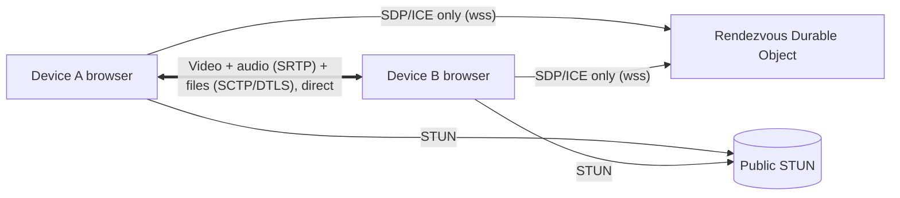

# Dline

Video call and send full-quality photos, videos and any other file between two devices on two
different networks, from a web page. **Media and files go directly between the devices (peer-to-peer).** A server is used
only to help the two devices find each other and punch through NAT.

Works on phones, tablets, laptops and desktops in current Chrome, Safari (iOS 16.4+), Firefox and Edge.
The two sides can be any mix (phone ↔ laptop, tablet ↔ phone…).

## How it meets the challenge

| Rule | How |
| --- | --- |
| Two devices, two networks | WebRTC ICE with two public STUN servers (IPv4 + IPv6), trickle ICE, ICE restart on network change |
| Share images, videos and any file | 128 KB blocks spread over up to 16 parallel direct connections ("lanes"), streamed from/to disk, every block SHA-256 verified |
| Camera video call | One-to-one call over the same connection, 720p30, echo cancellation and noise suppression |
| Entirely P2P | Media is DTLS-SRTP, files are SCTP over DTLS, both device-to-device. The connection panel shows "0 bytes have gone through any relay" |
| Server only for hole punching | The rendezvous room only swaps the WebRTC handshake (SDP/ICE, max 16 KB per message) and never sees media or files. There's also a **links-only mode with no server at all** |
| Reliable | Heartbeat, automatic ICE restart, "lost" within 15 s, network pre-check, explained "no P2P" screen |
| Fast | Pairing in ~1 s; files 5–15× faster than one connection on real-world (lossy, long) paths, and at the raw data-channel speed locally (see Results) |

**When P2P is impossible** (strict NAT on both sides, UDP blocked, IPv4-only ↔ IPv6-only), Dline says so
and explains why. A TURN relay can be switched on in Settings, but it is off by default and is always
labelled "Relayed, not peer-to-peer". Dline never relays without telling you.

## Using it

1. **Start a line.** You get a code (e.g. `K7M-Q3P`), a QR code and a link.
2. The other person opens the link, scans the QR code or types the code.
3. You're connected. Start a video call, send photos, videos or any other file (PDF, ZIP, documents…), or both at once.
   Photos and videos get a preview; other files get a Save button. Files that can run programs (APK, EXE…) show a warning.

**No-server mode:** "Pair with links instead" swaps an invite link and a reply link through any chat app.
The handshake travels in the URL fragment, which browsers never send to a server.

The band at the top draws the connection as a two-station metro line from You to Them: dashed while it
is being built, solid when direct, with a "Relay" interchange when relayed, and broken when lost. Each
tick on the line is a lane carrying files, and a train runs along it while files move. The plate under it
names the live path: *Direct on the same network*, *Direct over the internet (IPv4/IPv6)*,
or *Relayed, not peer-to-peer*. Tap it for details: candidate types, round trip, bitrate, packet loss,
video resolution and codec, and a 4-word **safety code** derived from both DTLS fingerprints. If both
people see the same words, nobody is in the middle.

## Architecture: modular monolith

One repository, one package, **one deployable**: a Cloudflare Worker that serves the static app and
hosts the rendezvous Durable Object.

```
src/
  app/            composition root (session state machine), Svelte screens and components
  modules/        each module exposes only index.ts; internals are private
    connection/   RTCPeerConnection, perfect negotiation, ctrl channel, heartbeat, watchdog, lanes
    pairing/      rendezvous WebSocket client, compact link codec, same-browser handoff
    call/         transceiver reuse, call state machine, camera/mic controls
    transfer/     block scheduler over lanes, per-block SHA-256 (WebCrypto), FileSinks, AIMD pacing
    diagnostics/  stats → path badge, pre-flight network check, no-P2P diagnosis, safety code
    settings/     opt-in TURN, safe localStorage
  contracts/      valibot schemas + ports (interfaces), shared by client and Worker
  shared/         config, emitter, async/timer helpers, formatting, ICE candidate parsing
  ui/             presentational design system (no module access)
  server/         Worker entry + RendezvousRoom Durable Object
```



**Boundaries are enforced, not just documented.**
- `npm run deps` (dependency-cruiser) fails on deep imports, cross-module shortcuts, cycles, and
  framework code inside modules.
- `npm run dup` (jscpd) fails on copy-paste.
- Every `FileSink` passes a shared contract test (Liskov).
- Browser APIs are injected as ports (`contracts/ports.ts`), so the core is unit-testable.

## Development

```bash
npm install
npm run dev        # app + Worker + Durable Object locally (http://localhost:5173)
npm run check      # types, lint, boundaries, duplicates, unit + Worker tests
npm run e2e        # two-browser Playwright tests with a fake camera
E2E_PREVIEW=1 npm run e2e   # same suite against the production build in workerd
npm run deploy     # build + wrangler deploy (needs a Cloudflare account)

# Speed through emulated real-world paths (see "Why files are fast" below)
BENCH=lan,mobile,far,clean npx playwright test -c playwright.bench.config.ts tests/bench/app.spec.ts --repeat-each 3
```

Camera access needs HTTPS (or `localhost`). Cloudflare Workers serve HTTPS by default.

## Results (measured)

Two Chromium profiles on one Windows laptop (localhost), production and dev builds:

| Check | Result |
| --- | --- |
| Pair with room code → connected | ~1 s |
| Pair with two links (no server) | invite link < 260 characters, connected after paste |
| Video call: ring/accept, frames both ways, camera off/on, second call reusing transceivers | pass |
| 6 MB video + 300 KB photo both ways during a call, SHA-256 verified, bytes identical | pass |
| File throughput on localhost vs raw data-channel ceiling (32 MB) | 23.9 MB/s warm, 13.6 MB/s for the first file of a session; one raw RTCDataChannel measured 20–23 MB/s on the same machine |
| File throughput during a video call | 23.1 MB/s (adaptive pacing stays out of the way when the link is healthy) |
| JS on first load | 59.9 KB gzipped (+ 9.4 KB CSS); repeat visits load from the service worker |

### Why files are fast: lanes

One WebRTC data connection (one SCTP association) sends one "congestion window" of data per round
trip and halves that window whenever a packet is lost. On a long or lossy path that caps it far below
the link speed: about **0.45 MB/s on a 100 ms path with 0.1 % loss**, whether the link is 5 or 500 Mbit/s.
Bigger buffers and chunks don't help.

So Dline opens **extra direct connections ("lanes")** next to the main one, in-band (no server
involved, STUN only, never a relay), and spreads 128 KB blocks over them. Each lane has its own
window, so the total grows with the number of lanes. How many: 3 extra when the devices are near
(lowest round trip ≤ 20 ms), 15 when far. Blocks go to whichever lane has room, each carries its own
SHA-256, and the receiver writes them by position in any order. A block that is overdue is sent again
on another lane, so one lane stuck recovering from loss can't hold up the end of a file. The
connection panel shows the number of lanes in use.

**Measured through emulated real-world paths** (`tests/bench`: a UDP proxy with rate limit, queue,
delay and random loss; both browsers are forced through it). Median of 3 runs for "after"; "before" is
the previous version (one channel per file), single run:

| Path | File | Before | After | Faster |
| --- | --- | --- | --- | --- |
| Same network (proxy only, 1 Gbit/s, 2 ms) | 64 MB video | 7.0 s | 3.4 s | 2.1× |
| | 20 × 1 MB photos | 1.1 s | 0.7 s | 1.6× |
| Mobile ↔ broadband (50 Mbit/s, 100 ms, 0.1 % loss) | 16 MB video | 30.6 s | 5.9 s | 5.2× |
| | 10 × 1 MB photos | 23.8 s | 2.8 s | 8.5× |
| Far path (30 Mbit/s, 220 ms, 0.2 % loss) | 8 MB video | 113.5 s | 13.4 s | 8.5× |
| | 6 × 1 MB photos | 53.3 s | 5.5 s | 9.7× |
| Long clean path (50 Mbit/s, 100 ms, no loss) | 8 MB video | 65.8 s | 4.3 s | 15× |
| | 4 × 1 MB photos | 4.2 s | 1.9 s | 2.2× |

The far path still uses only ~1/6 of its 30 Mbit/s: more lanes would help there, at the cost of
more connections per session. Real carrier paths still need measuring (matrix below).

**Still to do on real devices and networks** (fill in during testing, see PRD acceptance criteria):

| # | Device A network | Device B network | Path expected | Path seen | Connect time | Throughput |
| --- | --- | --- | --- | --- | --- | --- |
| 1 | Home Wi-Fi | Same Wi-Fi | Direct, same network | | | |
| 2 | Home Wi-Fi | Jio 5G | Direct, likely IPv6 | | | |
| 3 | Jio 5G | Airtel 4G/5G | Direct, likely IPv6 | | | |
| 4 | Airtel | Vi | Unknown | | | |
| 5 | Mobile hotspot | IPv4-only broadband | May fail without TURN | | | |
| 6 | Any | Any, TURN on | Relayed | | | |
| 7 | Wi-Fi, switched to mobile mid-call | Any | Recovers via ICE restart, else "lost" | | | |
| 8 | Laptop (Wi-Fi) | iPad (mobile hotspot) | Direct | | | |

## Known limits

- A browser can't keep a call running in the background like a native app.
- Each side sees the other's public IP address. That's inherent to a direct connection.
- One-to-one only. Groups would need a media server.
- Instagram/Facebook in-app browsers may block the camera. Dline detects them and says how to open the
  link in Chrome or Safari.
- Not yet verified in this repo: real carrier NAT behaviour (matrix above) and the NAT-lab scripts
  (`tests/natlab`, planned). The pre-flight check's symmetric-NAT detection relies on both STUN servers
  answering through the same socket.
